## Jonas Alberto

**Backend Software Engineer** · Node.js, Go & Python · Microsserviços & Clean Architecture

---

## 👨‍💻 Sobre mim

Engenheiro de Software Backend focado em **arquitetura de microsserviços**, **APIs resilientes** e **automação de infraestrutura**. Para mim, código funcionando é só o começo: manutenibilidade, observabilidade, segurança de dados e escalabilidade fazem parte do design desde o primeiro commit.

- 🏗️ **Arquitetura:** microsserviços, Clean Architecture, DTOs e contratos bem definidos entre serviços
- 🔭 **Confiabilidade:** telemetria, rate limiting e filtragem de dados sensíveis (PII)
- 🐳 **Entrega:** ambientes reproduzíveis com Docker e Makefiles, pipelines automatizados
- ✅ **Qualidade:** TDD, testes de integração e validação estrita de dados (Zod, Pydantic)
- 🤖 **IA aplicada:** integração de LLMs em fluxos conversacionais de produção

---

## 🛠️ Stack

<table>
  <tr>
    <td><b>Linguagens</b></td>
    <td>
      
      
      
      
      
    </td>
  </tr>
  <tr>
    <td><b>Backend & APIs</b></td>
    <td>
      
      
      
      
      
      
    </td>
  </tr>
  <tr>
    <td><b>Dados</b></td>
    <td>
      
      
      
      
      
      
    </td>
  </tr>
  <tr>
    <td><b>DevOps & Infra</b></td>
    <td>
      
      
      
      
      
      
    </td>
  </tr>
  <tr>
    <td><b>Qualidade</b></td>
    <td>
      
      
      
      
      
    </td>
  </tr>
</table>

---

## 🚀 Projetos em destaque

| Projeto | Descrição | Stack |
|---|---|---|
| **Gepetto / e-artesan**  Ambiente corporativo · PJ | Microsserviços backend para assistentes inteligentes via WhatsApp: DTOs, integrações, rate limiting, telemetria e filtragem de PII. | Node.js · TypeScript · Docker |
| [**API REST em Go**](https://github.com/BodeXX/api-rest-go) | Microsserviço de alta performance com padrões idiomáticos de Go, concorrência e estrutura modular. | Go |
| [**API de Consultas Médicas**](https://github.com/BodeXX/api-gerenciamento-consultas-medicas) | API RESTful com modelagem de domínio e validação rigorosa de dados. | Node.js · Express · MongoDB |
| [**Ritchie AI Guide**](https://github.com/BodeXX/ritchie-ai-guide) | Engenharia de prompt e estruturação de conhecimento no NotebookLM, criando um mentor de backend inspirado em Dennis Ritchie. | LLMs · Prompt Engineering |
| **Web Scraping com Clean Architecture** | MVPs de ingestão de dados com validação estrita e exportação estruturada. | Python · BeautifulSoup4 · Pydantic |
| [**Testes de API com Cypress**](https://github.com/BodeXX/teste-api-cypress-jonasAlbertoDeFreitasMoura) | Testes E2E e de integração para fluxos críticos de autenticação e integridade de dados. | Cypress · JavaScript |

---

## 📊 Estatísticas

  
  

Cards gerados diariamente via GitHub Actions, incluindo contribuições privadas.

---

## 📫 Contato

Aberto a conversas sobre backend, sistemas distribuídos e oportunidades.

